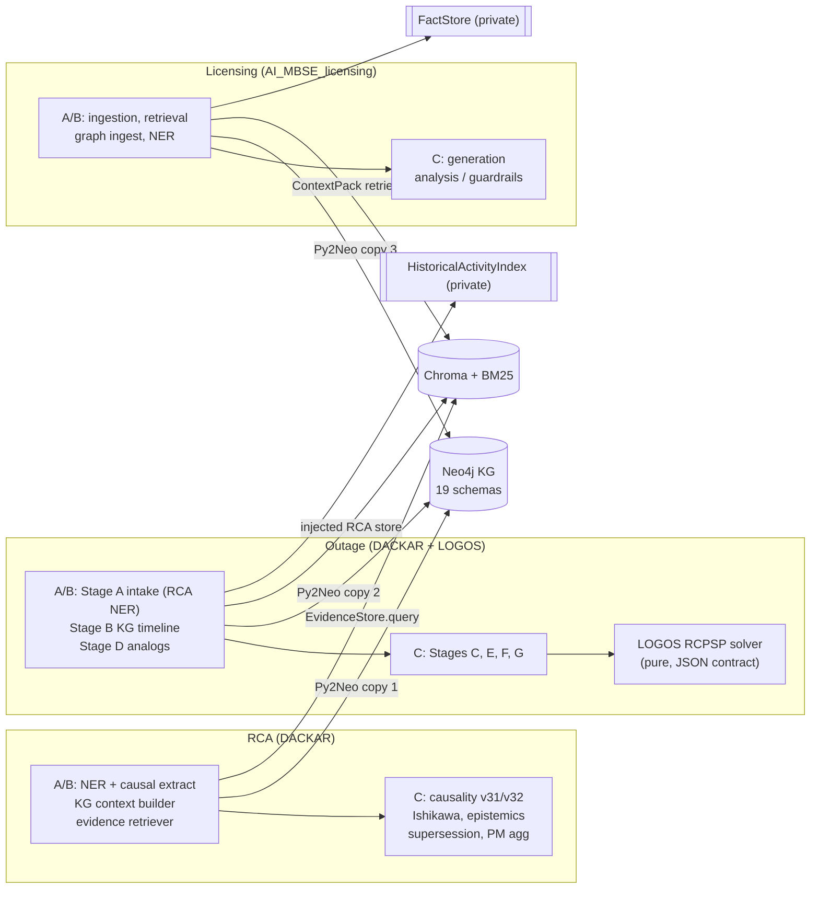
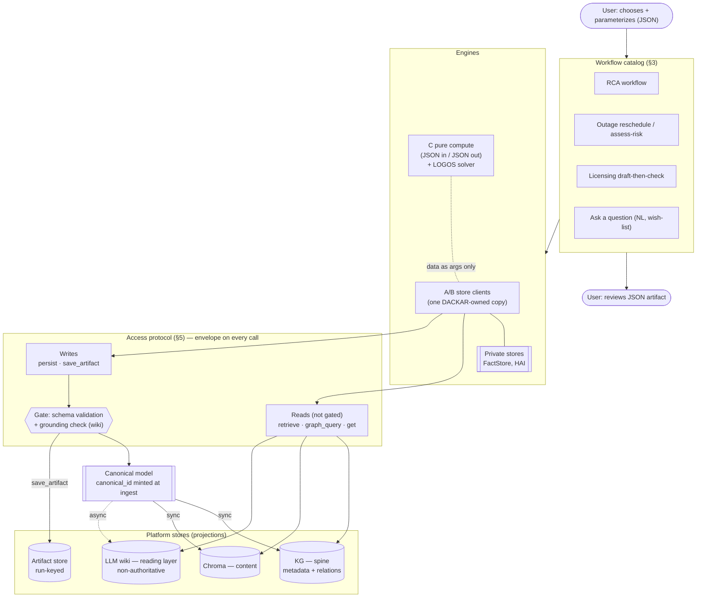
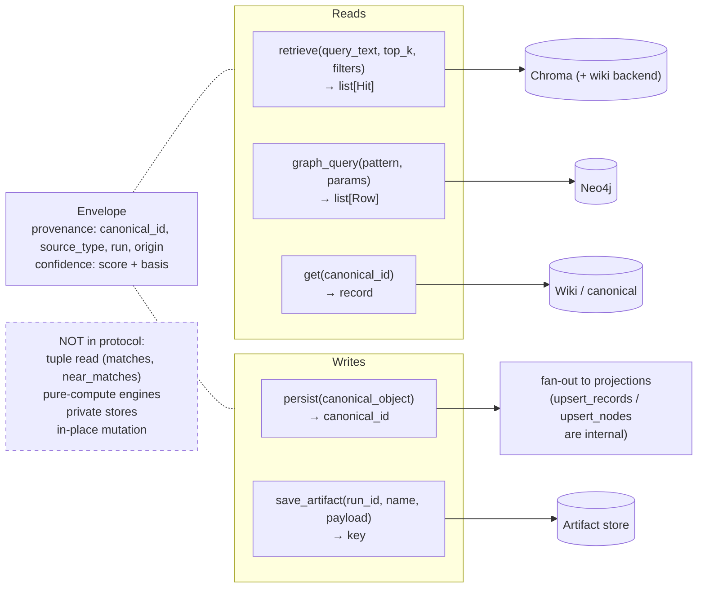
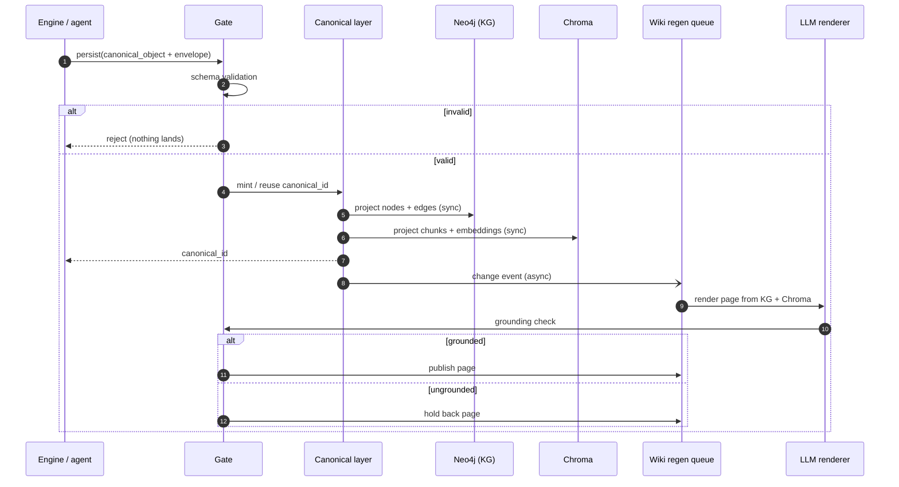
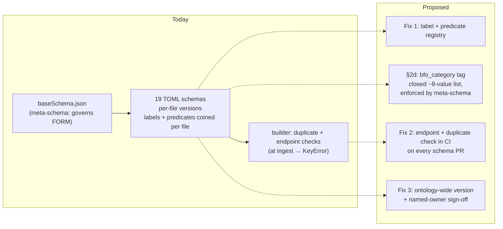
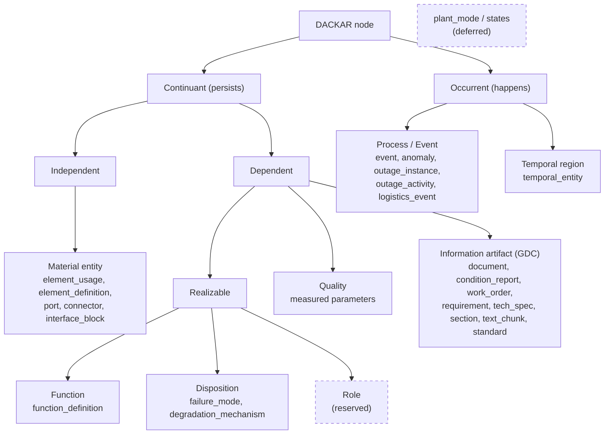

# Cross-Project Knowledge Platform — Diagrams and Assessment

**Companion to:** `cross_project_analysis.md` (Oct 27 meeting notes)
**Reviewed:** 2026-10-27 · local planning doc (untracked, do not `git add`)
**Contents:** Part 1 has diagrams of the current structure and the proposed changes. Part 2 is an
assessment of each proposed change, with confidence scores. Part 3 lists the factual claims that
were checked against the code.

Section references such as §5c point to `cross_project_analysis.md`.

---

## Part 1 — Diagrams

### 1.1 Today: three projects, duplicated A/B engines, shared stores

Each project wires its engines straight to the stores. The same A/B engines (KG client, retriever,
NER, ingestion) exist in more than one copy (§4c).

### 1.2 Proposed: layered platform

The proposal adds three layers above the stores: a workflow menu (§3), a small access protocol (§5),
and a canonical model with one write path (§2a). Pure-compute engines stay outside the protocol.

### 1.3 Protocol surface: 3 reads, 2 writes, 1 gate, 1 envelope

### 1.4 `persist` write path (sync vs async legs)

Note: steps 4–5 write to two stores that share no transaction. See assessment item P5.

### 1.5 Schema governance (§2c/§2d): what changes

### 1.6 Proposed top-category partition (§2d)

---

## Part 2 — Assessment of the proposed changes

**How to read the scores.** Confidence is my estimate (0–100%) that the proposal, as written, is
correct and will hold up once implemented without a significant redesign. It reflects the evidence
in the doc, the code checks in Part 3, and how much is still unspecified. It does not measure how
important the proposal is.

| Band | Meaning |
|---|---|
| 85–100 | Well supported; adopt as written |
| 70–84 | Sound direction; one or two details to pin down |
| 50–69 | Plausible but under-specified, or a real risk is unaddressed |
| < 50 | Evidence is thin or contradicts the proposal |

### 2.1 Summary scorecard

| # | Proposal | Section | Confidence | Verdict |
|---|---|---|---|---|
| P1 | Protocol covers platform stores only; pure compute and private stores stay out | §5a | **90%** | Adopt |
| P2 | Three read shapes: `retrieve`, `graph_query`, `get` | §5b | **80%** | Adopt; settle `graph_query` form |
| P3 | Tuple read kept as an engine-local method, not a protocol shape | §5b | **85%** | Adopt |
| P4 | Two write intents: `persist`, `save_artifact` | §5c | **80%** | Adopt |
| P5 | `persist` fans out synchronously to KG + Chroma | §5c | **55%** | Needs a consistency story |
| P6 | Wiki regenerated asynchronously with a grounding check | §5c/§5d/§5g | **60%** | Direction right; "grounded" undefined |
| P7 | Gate on every write, "already merged" | §5d | **50%** | Claim not found in code; re-verify |
| P8 | Envelope: provenance (incl. origin) + confidence with basis | §5e | **75%** | Adopt; fix the field list now |
| P9 | Protocol = agent tool surface | §5f | **80%** | Adopt as framing |
| P10 | Two store tiers, graduation on second consumer | §2a | **80%** | Adopt; name the owner |
| P11 | Controlled vocabulary of labels + predicates | §2c #1 | **90%** | Adopt; evidence is strong |
| P12 | Endpoint check moved to CI | §2c #2 | **75%** | Adopt; the validator was not found |
| P13 | Ontology-wide version + sign-off | §2c #3 | **85%** | Adopt; one premise needs a fix |
| P14 | `bfo_category` tag from a closed list | §2d | **70%** | Adopt for clear cases; a few mappings are shaky |
| P15 | JSON interchange + curated workflow catalog | §3 | **85%** | Adopt |
| P16 | Consolidate A/B engines into DACKAR (Py2Neo, retriever, NER, chunk schema) | §4c | **75%** | Adopt; risk is in the merge, not the idea |
| P17 | Next canonical probe on a non-document concept | §6 #7 | **90%** | Adopt; should come before P14/P5 hardening |

Overall: the **direction** is well supported (about 80%). The **write-side details** (P5–P7) are the
weakest part and should be the main discussion items at the meeting.

### 2.2 Per-proposal notes

**P1 — Protocol scope limited to platform stores (90%).** This is the strongest call in the doc. §4
shows that most engines are pure compute over dicts (causality, Ishikawa, epistemics, outage
stages C/E/F/G, LOGOS). Wrapping them would add a layer without benefit. The disposal of §4d gaps
#3/#5/#6 as engine-structure concerns holds up: TSKR does hold an optional
`doc_extraction_store` and calls `.query` on it mid-scoring (`tskr_temporal_scorer.py:110,1118`).
That makes it a consumer of a read, not a new shape. *Residual risk:* the "data schema" contract for
pure-compute engines then needs its own home (who owns the JSON shapes?). It is outside the
protocol, but still has to be written down.

**P2 — Three read shapes (80%).** `retrieve` matches `EvidenceStore.query` as it exists today. A
separate `graph_query` is clearly needed. *Open:* templated vs raw Cypher (§6 #1). I recommend
named templates plus a read-only passthrough that is off by default. Raw Cypher on the agent tool
surface (P9) is an injection and runaway-query risk. *Note:* `get(canonical_id)` assumes every
concept already has a `canonical_id`. That is true only for documents today (§2b), so `get` is
partly hypothetical for other families.

**P3 — Tuple read stays local (85%).** Confirmed: `DocExtractionStore.query` returns
`Tuple[List[SemanticMatch], List[SemanticMatch]]` with `similarity_threshold`, `near_match_window`,
and `exact_doc_ids` keywords (`RCA/doc_extraction/store.py:248`). Keeping it engine-local is right.
An alternative worth noting: `retrieve` could return `Hit`s with a `band` field
(`match`/`near_match`), so a near-match caller could use the shared shape later without the
protocol changing.

**P4 — Two write intents (80%).** The identity-keyed vs run-keyed split is real: `ArtifactStore`
already has `save(run_id, artifact_name, payload)` and `save_list(...)`
(`RCA/orchestrators/artifact_store.py:65,69`). *Gaps not covered:* (a) **updates and supersession**:
is a new document version a `persist` of the same `canonical_id`, or a new one plus a
`supersedes` edge? (b) **deletes / retractions**: there is no intent for them, and quarantining
agent-authored writes (P8's "origin") eventually needs one. (c) **relation-only writes**: an RCA
asserting `caused_by` between two existing concepts is neither a new canonical object nor a run
artifact.

**P5 — Synchronous fan-out to KG + Chroma (55%).** The doc says the caller "cannot write one store
without the others, so the stores cannot desync." That only holds if the fan-out is atomic, and
Neo4j and Chroma share no transaction. A Chroma failure after the Neo4j commit leaves them out of
sync. The doc needs one of these: an outbox/journal in the canonical layer with idempotent replay,
canonical-first write with projections rebuilt from it, or a reconciliation job. "Cheap,
deterministic" is also optimistic for Chroma: embedding is the slowest step in the path. *This is
the item most likely to force a redesign.*

**P6 — Async wiki with grounding check (60%).** Async is correct for LLM rendering. But "the page
must trace to its canonical source" is not yet testable. Define it: for example, every sentence
carries a citation to a `canonical_id`/chunk, and an entailment or claim check passes above a
threshold. Also define staleness: the page shows its source version and is marked stale when the
canonical concept moves ahead of it. Both are already listed in §6 #6. The score reflects that they
are open, not that the idea is wrong.

**P7 — Gate on every write, "already merged" (50%).** The principle (writes gated, reads not) is
sound and would score about 90% by itself. The **factual premise** fails: `RCAArtifactValidator`
exists (`RCA/validation/schema_validator.py:99`), but **no `ValidationGate` class was found** in
DACKAR (working tree or `origin/main`), AI_MBSE_licensing, or LLM_Licensing. The only git hit for
the string is this notes commit. It may live on `mandd/rca-08a-validation` or under another name.
Correct it before the meeting, because §5d presents the gate as existing infrastructure.

**P8 — Envelope (75%).** Provenance with `origin` and confidence with a named `basis` are the right
first-class fields, and epistemics already models this inside RCA. To make it decidable at the
meeting, propose a concrete minimal field list, for example:
`canonical_id`, `source_type`, `source_ref` (raw id), `run_id`, `origin`
(`deterministic|agent|human`), `producer` (engine + version), `created_at`, `confidence.score`,
`confidence.basis` (`retrieval_similarity|model_asserted|human_confirmed|rule`). *Caution:* scores
with different bases are not comparable. Say explicitly that consumers must not rank across bases.

**P9 — Protocol as agent tool surface (80%).** It is a natural consequence of P2/P4 and keeps
agents behind the gate. The risks are in P2's Cypher choice and in P4's missing update/retract
intents. Agents will need both.

**P10 — Two store tiers (80%).** Both cited private stores exist (`AI_MBSE_licensing/src/store/fact_store.py`;
HistoricalActivityIndex in outage). The rules (single consumer, derived, reproducible) are good.
*Open:* who decides graduation (§6 #5), and how a second consumer is *detected*. Without a check
(for example, an import-boundary lint), graduation depends on people noticing.

**P11 — Controlled vocabulary (90%).** The evidence is stronger than the doc says. Across the 19
schemas there are **149 relation types, and almost all are defined once**. Causal predicates alone
include `caused_by`, `has_cause`, `leads_to`, `leads_to_effect`, `leads_to_consequence`,
`leads_to_hazard`, `results_in`, `precipitates`. Also present: per-file prefixed predicates
(`text_chunk_mentions`, `table_mentions`, `text_chunk_belongs_to_document`,
`table_belongs_to_document`). `resolve_node_label` / `resolve_node_label_strict` exist as described
(`kg_schema_builder_workflow.py:233,256`). Consider citing these numbers at the meeting.
*Effort warning:* collapsing the existing variants is a migration with data impact, not just a
registry. Scope it as "registry for new schemas now, consolidate existing ones later."

**P12 — Endpoint check in CI (75%).** The idea is cheap and right. The **premise** that
`knowledge_graph/validator/kg_model_validator.py` exists locally was **not confirmed**: no such file
was found in DACKAR or the sibling repos. If it is on another machine or branch, say where. If not,
Fix #2 is a small new test rather than "repoint and merge." It is still low effort, since the
builder's endpoint logic exists.

**P13 — Ontology-wide version + sign-off (85%).** The process fix is right. The stated premise
"each file carries its own `version = 1.0`" is inaccurate: today there are **14 × `1.0`, 3 × `1.1`,
1 × `2.1.0`, 1 × `3.4`**. That makes the case *stronger* (versioning is already inconsistent in
scheme as well as value), so update the wording.

**P14 — `bfo_category` tag (70%).** Taking only the top-level partition and skipping the BFO
machinery is a good boundary. Most mappings are sound. Ones that will draw challenge:
- `requirement` / `technical_specification` as *information artifact*: in BFO the requirement
  *content* is a GDC, but some will argue requirements are prescriptions about a function. Fine
  for a tag, but expect the debate.
- `text_chunk`, `section` are artifacts *about* artifacts. That is acceptable, but `document` and
  `text_chunk` sharing a category gives "all Information artifacts" queries mixed granularity.
- `anomaly` can be an *event* (an excursion) or a *quality* state (out of band). The label is
  ambiguous in practice.
- Outage has nodes not listed (`crew`, and resources/constraints). §2d says resource = material
  entity, but `crew` is a group of people with a *role*. That is the first real use of the reserved
  Role category, and it should be tested before the closed list is frozen.
- The list in the table has **8 categories**, while the text says "~7". Fix the count.
- The ISO/IEC 21838-2 credibility argument holds only if the mapping is defensible. A shaky tag is
  worse than none in front of a regulator.

**P15 — JSON + workflow catalog (85%).** It matches current reality (each project is already a
hard-wired pipeline). Curated whole-workflows are the right default. "Ask a question" as a workflow
is a clean way to keep NL querying out of the protocol.

**P16 — Consolidation of A/B engines (75%).** Three `Py2Neo` wrappers and two
Chroma+BM25+RRF retrievers are clear duplication (the DACKAR `Py2Neo` is at
`knowledge_graph/py2neo.py:48`; licensing has `VectorStoreBackend` at
`src/retrieval/vector_store_backend.py` and `chunk_metadata.schema.json`). *Risks:* licensing's
retriever is richer (multi-view, KG-expand, amendment-aware). Adopting it as the unified retriever
means RCA's evidence tests must pass against it, so plan a parity test suite first. `_safe_token()`
(cited in §6 #1) was **not found** in AI_MBSE_licensing `src/`. Confirm its location.

**P17 — Non-document canonical probe (90%).** This is the most valuable next step in the doc. Two
other proposals depend on it: `get(canonical_id)` (P2) and `persist` fan-out (P5) are only proven
for documents. An outage activity (a process with time and resource links) would test both the
canonical pattern and the §2d partition at once. Recommend doing it **before** freezing the
envelope and the category list.

### 2.3 Gaps the notes do not yet cover

| Gap | Why it matters | Confidence it needs a decision soon |
|---|---|---|
| Atomicity / recovery of `persist` fan-out | The one-write-path guarantee depends on it (P5) | 85% |
| Update, supersession, and retract write intents | Versioned documents and agent quarantine both need them (P4) | 80% |
| Relation-only writes (`caused_by` between existing concepts) | RCA output is mostly relations | 70% |
| Access control / multi-tenancy across projects | Licensing material may have distribution limits that RCA/outage users should not see | 65% |
| Ownership of pure-compute JSON data schemas | P1 moves them out of the protocol, but someone must own them | 60% |
| Embedding-model versioning across the shared Chroma | `DocExtractionStore` already raises on model-version mismatch; a shared retriever inherits this | 60% |

### 2.4 Suggested order for the meeting

1. Correct the three factual premises (P7 `ValidationGate`, P12 validator, P13 versions) so the
   doc is not challenged on facts.
2. Decide P5 consistency strategy and P4 update/retract intents. These are the design risks.
3. Agree the envelope field list (P8) and the `graph_query` form (P2).
4. Commit to the non-document probe (P17), then freeze the `bfo_category` list (P14) after it.

---

## Part 3 — Claims checked against the code (2026-10-27)

| Claim in notes | Result | Evidence |
|---|---|---|
| 19 KG schemas + `baseSchema.json` meta-schema | ✅ Confirmed | `knowledge_graph/schemas/` (19 `.toml` + `baseSchema.json`) |
| `resolve_node_label(*candidates)` exists | ✅ Confirmed | `kg_schema_builder_workflow.py:233` (plus `_strict` at :256) |
| Predicates coined per file | ✅ Confirmed, stronger than stated | 149 relation types, mostly unique; 8+ causal variants |
| Each file has `version = 1.0` | ❌ Inaccurate | 14×`1.0`, 3×`1.1`, 1×`2.1.0`, 1×`3.4` |
| `kg_model_validator.py` exists (local) | ❓ Not found | Not in DACKAR, AI_MBSE_licensing, or LLM_Licensing |
| `ValidationGate` already merged | ❓ Not found | Only hit is the notes commit `b638f17f` |
| `RCAArtifactValidator` exists | ✅ Confirmed | `RCA/validation/schema_validator.py:99` |
| `Py2Neo` wrapper in DACKAR | ✅ Confirmed | `knowledge_graph/py2neo.py:48` |
| `EvidenceStore.query` is the canonical read shape | ✅ Confirmed | `RCA/orchestrators/evidence_retriever.py:152` (Protocol) |
| `DocExtractionStore.query` returns a 2-tuple with extra kwargs | ✅ Confirmed | `RCA/doc_extraction/store.py:248` |
| TSKR scorer holds an optional injected store | ✅ Confirmed | `tskr_temporal_scorer.py:110,1118` |
| Supersession mutates the bundle in place | ✅ Confirmed | `supersession.py:185` docstring "Modifies bundle in-place" |
| Causality exposes `refine_with_evidence` | ✅ Confirmed | `causality_engine_v32.py:1046`; Protocol in `signal_evidence/contracts.py:34` |
| `ArtifactStore.save` / `save_list` | ✅ Confirmed | `RCA/orchestrators/artifact_store.py:65,69` |
| Licensing `VectorStoreBackend`, `FactStore`, chunk schema | ✅ Confirmed | `AI_MBSE_licensing/src/retrieval/vector_store_backend.py`, `src/store/fact_store.py`, `src/schemas/chunk_metadata.schema.json` |
| Licensing `_safe_token()` | ❓ Not found | Not in `AI_MBSE_licensing/src` |
| PR#73 merged (ontology fixes) | ⚠️ Not verified | No commit message matched; check by PR number on GitHub |
| Outage schema labels (`outage_instance`, `outage_activity`) | ✅ Confirmed | `outageSchema.toml:8,19`; also `crew` (:29), which is not mapped in §2d |
